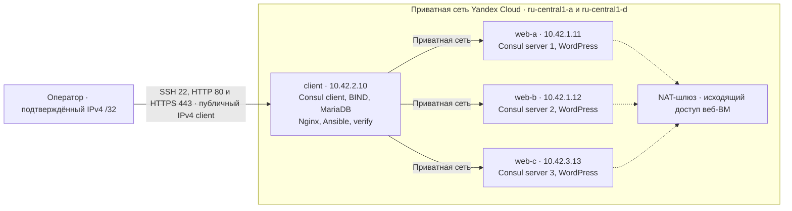
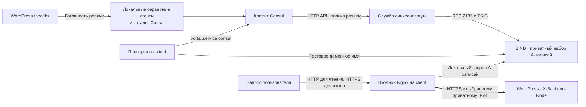

# ДЗ09. Обнаружение сервисов и DNS с Consul

Три серверных агента Consul регистрируют три экземпляра портала WordPress из ДЗ08 и проверяют их готовность. Четвёртая ВМ запускает клиентский агент Consul, собственный BIND, общую MariaDB, входной Nginx и скрипты настройки и проверки. [Задание](docs/zadanie.txt)

## Размещение



Веб-реплики используют одну БД и одинаковую тему. Портал содержит восемь перенесённых материалов и карточку **«ДЗ09. Consul и DNS»** с описанием задания. Начальные материалы импортируются в общую MariaDB по уникальным адресам статей. Повторный запуск сохраняет существующие записи. На каждой веб-ВМ Ansible регистрирует сервис `portal` с отдельным идентификатором и локальным `/healthz`, который проверяет WordPress и соединение с MariaDB.

## Как меняются DNS-ответы и проходит запрос



Служба на `client` запрашивает Consul каждые пять секунд и сверяет ID и адреса с инвентарём. При изменении списка здоровых реплик она заменяет набор A-записей одной транзакцией. При недоступности Consul сохраняется предыдущий набор. Nginx повторно разрешает имя через локальный BIND и проверяет сертификат выбранной реплики.

## Подготовка

На Windows нужны Git, PowerShell 5.1 или 7, Python 3.12–3.14 и OpenSSH. В Yandex Cloud выберите облако и каталог, где оператор может создавать Compute, VPC, Cloud Functions и сервисный аккаунт, назначать ему доступ к ВМ и вызывать приватную функцию. Для проверки отключения `web-b` сервисный аккаунт клиентской ВМ получает `compute.operator` только на эту ВМ.

```powershell
git clone https://github.com/airiga1897/OTUS_DZ09.git
Set-Location OTUS_DZ09
git branch --all
# Если файлы стенда находятся в другой ветке, выберите её.
# git switch 'ИМЯ_ВЕТКИ'
.\scripts\setup.ps1
# Если config/lab.local.json ещё не создан, скопируйте файл примера.
# Copy-Item config/lab.local.example.json config/lab.local.json
.\.tools\bin\yc.exe --config .tools/yc-config.yaml init
```

В `config/lab.local.json` укажите `portal.dz09.test` в поле `portal_name` или выберите другое имя для частной зоны BIND. При необходимости добавьте подтверждённые IPv4 с маской `/32`. Основной сценарий получает временный IAM-токен через профиль YC. Можно передать `YC_CLOUD_ID`, `YC_FOLDER_ID` и `YC_TOKEN` в окружении PowerShell. Если нужен локальный файл, используйте корневой `.env` по образцу `.env.example`, оставьте права чтения только текущему владельцу и явно передайте `--env-file`. Значения записываются в формате `KEY=VALUE`.

## Запуск, проверка и удаление

Из корня клона:

```powershell
.\.venv\Scripts\python.exe scripts/lab.py deploy --plugin-dir .tools/providers
.\.venv\Scripts\python.exe scripts/lab.py verify
.\.venv\Scripts\python.exe scripts/lab.py open
```

`deploy` проверяет размещение, подтверждает IPv4 оператора через приватную Cloud Function и создаёт инфраструктуру. Terraform state остаётся на компьютере оператора. После подключения по SSH клиентская ВМ запускает Ansible по приватной сети. Для повтора используйте тот же клон. Если SSH недоступен, проверьте маршрут TCP/22 и соответствие исходящего адреса списку `admin_cidrs`.

`verify` выполняется на клиентской ВМ. Он проверяет три голосующих сервера и отдельного клиента Consul, а также точные наборы IP в Consul DNS и BIND. В каждом из двух сценариев отдельно останавливается Nginx на `web-b` или сама ВМ. Ожидаемый переход в обоих DNS — **три IP → два → три**. Проверка запрашивает портал по каждому доступному адресу и через входной прокси, подтверждает девять карточек, статью ДЗ09 и имя ответившей реплики в `X-Backend-Node`. При ошибке сценарий пытается восстановить остановленный сервис или ВМ. Скрипт можно запустить непосредственно после входа на `client` командой `sudo /usr/local/lib/otus-dz09/verify.py`.

`open` выводит HTTP-ссылки на портал и карточку ДЗ09 по публичному IPv4 `client`. Откройте главную страницу в браузере и перейдите по карточке «ДЗ09. Consul и DNS». По HTTP прокси отдаёт главную страницу, статьи и таблицу стилей. HTTP, HTTPS и SSH доступны с подтверждённых `/32`.

После проверки удалите стенд с компьютера оператора:

```powershell
.\.venv\Scripts\python.exe scripts/lab.py destroy --plugin-dir .tools/providers
```

`destroy` проверяет удаление через state и API YC. При ошибке файлы восстановления сохраняются. Отдельный `test-cycle` создаёт временный стенд, проверяет его и удаляет. После прерывания его можно очистить командой `destroy --test-context` с тем же каталогом провайдеров.

После успешного `destroy` можно удалить локальный файл профиля YC с настройками и сохранёнными данными входа этого клона. Выполните команду из корня клона.

```powershell
Remove-Item -LiteralPath .\.tools\yc-config.yaml
```

## Дополнительная часть задания

Для дополнительной части был использован собственный BIND с частной DNS-зоной и тестовым именем `portal.dz09.test`. Скрипт автоматически обновлял A-записи по данным Consul о доступных экземплярах WordPress. Консольная проверка подтвердила переход `3 → 2 → 3` в Consul DNS и BIND в двух сценариях — при остановке Nginx и при отключении веб-ВМ. Интеграция с публично делегированным доменом в этом стенде не проверялась.

## Подтверждённые результаты

В Yandex Cloud стенд удалили, развернули заново на четырёх ВМ и выполнили полный сценарий проверки. До каждого отказа и после восстановления Consul DNS и BIND возвращали `10.42.1.11`, `10.42.1.12` и `10.42.3.13`.

- При остановке Nginx на `web-b` оба DNS возвращали `10.42.1.11` и `10.42.3.13`. Через входной прокси ответил `web-c`.
- При остановке ВМ `web-b` оба DNS возвращали тот же набор из двух адресов. Через входной прокси ответил `web-a`.
- После каждого восстановления проверка подтвердила доступность портала по всем трём адресам.
- Автоматические HTTP-запросы по публичному IP подтвердили доступность главной страницы, карточки ДЗ09 и стилей, а также блокировку входа и POST. Форма входа открылась по HTTPS с проверкой сертификата. Ручная проверка в браузере выполняется оператором по ссылке из `open`.
- После проверки `destroy` удалил 15 ресурсов. Удаление подтверждено по Terraform state и API Yandex Cloud.

### Ожидание и результат повторной проверки

| Этап | Ожидается в Consul DNS и BIND | Получено в обоих DNS | Ответ через Nginx |
|---|---|---|---|
| Исходное состояние | Все три IP | `10.42.1.11`, `10.42.1.12`, `10.42.3.13` | `web-b` |
| Nginx на `web-b` остановлен | IP `web-b` исчезает, портал доступен | `10.42.1.11`, `10.42.3.13` | `web-a` |
| Nginx на `web-b` запущен | IP `web-b` возвращается | `10.42.1.11`, `10.42.1.12`, `10.42.3.13` | `web-a` |
| ВМ `web-b` выключена | IP `web-b` исчезает, портал доступен | `10.42.1.11`, `10.42.3.13` | `web-a` |
| ВМ `web-b` запущена | IP `web-b` возвращается | `10.42.1.11`, `10.42.1.12`, `10.42.3.13` | `web-c` |

Строка `active` подтверждает, что Nginx на `web-b` работал перед остановкой. Через прокси может ответить любая доступная реплика. По публичному HTTP ожидался доступ к главной странице, статье ДЗ09 и стилям при блокировке входа и POST. Повторная проверка это подтвердила.

Локально пройдены 13 тестов Python (`python -B -m unittest discover -s tests -v`) и две проверки Terraform с подставным провайдером (`terraform -chdir=terraform test` после инициализации).

## Границы проверки

Сценарий проверяет потерю одной веб-реплики. Доступ снаружи, BIND и MariaDB зависят от клиентской ВМ.
